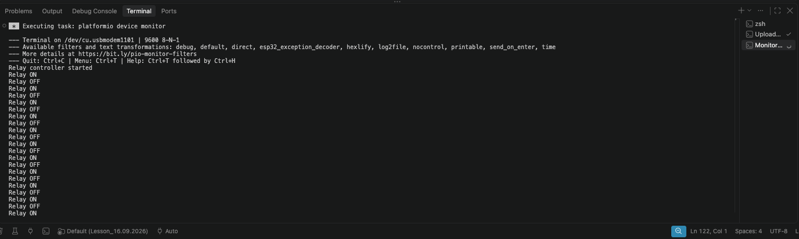

# Керування реле апаратним таймером — 12.10.2026

[Код для ESP32-S3 / Arduino](src/main.cpp). Апаратний таймер визначає стан реле, а `loop()` перемикає GPIO4 та виводить зміни в Serial Monitor. Обробник переривання не викликає `digitalWrite()`.

- `TEST_MODE = true`: 5 с увімкнено, 15 с вимкнено.
- `TEST_MODE = false`: 15 хв увімкнено, 45 хв вимкнено.

## Результат роботи

